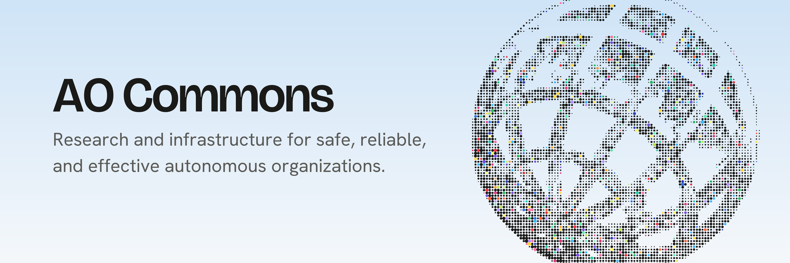

  <a href="https://aocommons.org">Website</a> •
  <a href="https://ao-commons.github.io/knowledge-graph/">Knowledge Graph</a> •
  <a href="mailto:hello@aocommons.org">Contact</a>

## About

Autonomous organizations (AOs) are emerging as AI agents take on persistent roles, coordinate work, and exercise delegated authority. Understanding their safety means looking beyond individual models and agents to the organizations they form: how decisions are made, how authority is distributed, how failures emerge, and how humans retain oversight.

AO Commons is a nonprofit research initiative that brings together researchers, builders, and institutions to build a shared understanding of these systems through empirical research, open infrastructure, and collaboration.

- **Research:** organizational-level risks, coordination failures, governance, and safeguards, informed by real-world AO deployments.
- **Build:** open infrastructure for mapping the field, collecting comparable evidence, and evaluating autonomous organizations.
- **Convene:** research collaborations, fellowships, and convenings that connect independent researchers and builders.

## Projects

**[Knowledge Graph](https://github.com/AO-Commons/knowledge-graph)**: a maintained map of research on autonomous organizations, with a taxonomy, a scholarly graph, and claims traced to the sentence they came from. [Browse it](https://ao-commons.github.io/knowledge-graph/) or [suggest an addition](https://github.com/AO-Commons/knowledge-graph/issues/new?template=suggest-addition.yml).

> [!NOTE]
> The Knowledge Graph is in preview and rolling out gradually. It is not yet ready for functional use, but contributors are welcome to explore it and add their work.

More research tools, methods, and datasets will be published here as they become ready.

## Get involved

We welcome researchers, engineers, and practitioners working on organizational AI safety, empirical evaluation, and shared research infrastructure.

- Read the Knowledge Graph's [contributing guide](https://github.com/AO-Commons/knowledge-graph/blob/main/CONTRIBUTING.md).
- Open an issue in the relevant repository for questions, bugs, or feedback.
- Learn more at [aocommons.org](https://aocommons.org), or write to [hello@aocommons.org](mailto:hello@aocommons.org).
